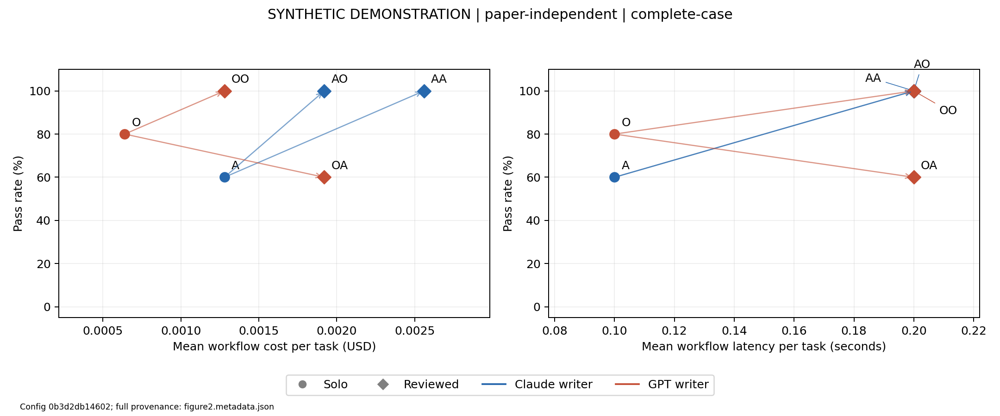

# Crosscode — SYNTHETIC DEMONSTRATION — no real model results

Design: paper-independent. Population: complete-case. Configuration: `0b3d2db146022ac420d76679f7f8cc721a258ae7f73410353986655b4538d4c5`.

[Task-by-task audit: requirements, exact model responses, code and evaluator evidence](../task-audit/index.md).

Requested models: claude-opus-5-5, gpt-6.1-sol. Returned: SYNTHETIC-A, SYNTHETIC-O.

Subset: full; selected tasks: 5; split: instruct; repeats: 1. Both efforts: medium / medium; output caps: 16384 / 16384.

Full dataset revisions, requested/returned identifiers, settings and population accompany every artifact in metadata sidecars.

Dataset revision: `"synthetic-v1"`.

Table 2: overall metrics (rates are fractions, SID is percentage points). `selected` and `attempted` count task-repetition workflows; denominator is explicit. CC includes only task-repetition pairs evaluated in every requested condition. Reliability includes terminal invalid attempts as failures; budget-unstarted finals and infrastructure failures are excluded.

| condition | passed | evaluated | denominator | pass_rate | ci_low | ci_high | sid_pp | mean_workflow_cost_usd | mean_workflow_latency_s | cross_condition_regression_rate | cross_condition_denominator |
| --- | --- | --- | --- | --- | --- | --- | --- | --- | --- | --- | --- |
| A | 3 | 5 | 5 | 0.6 | 0.2 | 1 | NA | 0.00128 | 0.1 | NA | 0 |
| O | 4 | 5 | 5 | 0.8 | 0.4 | 1 | NA | 0.00064 | 0.1 | NA | 0 |
| AO | 5 | 5 | 5 | 1 | 1 | 1 | 40 | 0.00192 | 0.2 | 0 | 5 |
| OA | 3 | 5 | 5 | 0.6 | 0.2 | 1 | -20 | 0.00192 | 0.2 | 0.4 | 5 |
| AA | 5 | 5 | 5 | 1 | 1 | 1 | 40 | 0.00256 | 0.2 | 0 | 5 |
| OO | 5 | 5 | 5 | 1 | 1 | 1 | 20 | 0.00128 | 0.2 | 0 | 5 |

Coverage and status counts (all selected workflows, with evaluated/pass/fail for this population):

| condition | selected | attempted | valid | evaluated | passed | failed | not_run | infrastructure_failures | invalid_attempts |
| --- | --- | --- | --- | --- | --- | --- | --- | --- | --- |
| A | 5 | 5 | 5 | 5 | 3 | 2 | 0 | 0 | 0 |
| O | 5 | 5 | 5 | 5 | 4 | 1 | 0 | 0 | 0 |
| AO | 5 | 5 | 5 | 5 | 5 | 0 | 0 | 0 | 0 |
| OA | 5 | 5 | 5 | 5 | 3 | 2 | 0 | 0 | 0 |
| AA | 5 | 5 | 5 | 5 | 5 | 0 | 0 | 0 | 0 |
| OO | 5 | 5 | 5 | 5 | 5 | 0 | 0 | 0 | 0 |

Writer/reviewer costs and latencies, true review-transition counts, unknown-cost coverage and bootstrap intervals: [all metrics](all_metrics.csv).

Genuine transitions for the actual draft received by each reviewer (only observed before/after pairs contribute; drafts without scores are unscorable):

| condition | reviewer_fixes | reviewer_regressions | kept_pass | kept_fail | unscorable_drafts |
| --- | --- | --- | --- | --- | --- |
| AO | 2 | 0 | 3 | 0 | 0 |
| OA | 1 | 2 | 2 | 0 | 0 |
| AA | 2 | 0 | 3 | 0 | 0 |
| OO | 1 | 0 | 4 | 0 | 0 |

Table 3: writer-by-reviewer matrix; solo rate accompanies writer.

| writer | Claude reviewer | GPT reviewer |
| --- | --- | --- |
| Claude Opus 5.5 (solo 60.0%) | 100.0% (+40.0 pp) | 100.0% (+40.0 pp) |
| GPT-6.1 Sol (solo 80.0%) | 60.0% (-20.0 pp) | 100.0% (+20.0 pp) |

Table 4: exact paired McNemar, separately per repetition. BH family is all requested condition pairs in each population/repetition (15 for six conditions); full family exported. NA means no paired observations. No pooled task-repetition significance test.

| comparison | first | second | rep | paired_tasks | first_only | second_only | p_value | bh_adjusted | family_size |
| --- | --- | --- | --- | --- | --- | --- | --- | --- | --- |
| OA versus O | OA | O | 0 | 5 | 1 | 2 | 1 | 1 | 15 |
| OO versus O | OO | O | 0 | 5 | 1 | 0 | 1 | 1 | 15 |
| AO versus A | AO | A | 0 | 5 | 2 | 0 | 0.5 | 1 | 15 |
| AA versus A | AA | A | 0 | 5 | 2 | 0 | 0.5 | 1 | 15 |
| AA versus AO | AA | AO | 0 | 5 | 0 | 0 | 1 | 1 | 15 |
| AO versus OA | AO | OA | 0 | 5 | 2 | 0 | 0.5 | 1 | 15 |

Table 5: first two task IDs per condition and true same-draft transition, ordered by ID then repetition. Explanations require verified local annotations.

| task_id | rep | condition | actual_draft_outcome | final_outcome | reviewer_action | interpretation | transition |
| --- | --- | --- | --- | --- | --- | --- | --- |
| Synthetic/12 | 0 | AO | False | True | pending inspection (provisional) | pending inspection (provisional) | fix |
| Synthetic/9 | 0 | AO | False | True | pending inspection (provisional) | pending inspection (provisional) | fix |
| Synthetic/17 | 0 | OA | False | True | pending inspection (provisional) | pending inspection (provisional) | fix |
| Synthetic/12 | 0 | OA | True | False | pending inspection (provisional) | pending inspection (provisional) | regression |
| Synthetic/4 | 0 | OA | True | False | pending inspection (provisional) | pending inspection (provisional) | regression |
| Synthetic/12 | 0 | AA | False | True | pending inspection (provisional) | pending inspection (provisional) | fix |
| Synthetic/9 | 0 | AA | False | True | pending inspection (provisional) | pending inspection (provisional) | fix |
| Synthetic/17 | 0 | OO | False | True | pending inspection (provisional) | pending inspection (provisional) | fix |

Figure 2 uses precisely Table 2 coordinates; workflow costs include writer and reviewer, with intentional shared drafts charged to each hypothetical standalone workflow. Actual purchased calls are counted once in the ledger. Independent-mode arrows compare independently sampled pipelines.

Actual API spending (whole run): $0.000000; unresolved reservation: $0.000000. Costs on the plot are synthetic token-price examples, latency is a fixed synthetic fixture; actual API spending is zero. Partial workflow cost sums include known values only; cost_known_rows identifies coverage. Actual run spending is attributed once to the first requested condition using each call (canonical condition order), across all selected work, independently of analysis population; shared writer attribution is bookkeeping. Cross-condition regression denominator is paired evaluated workflows; it does not identify reviewer-induced regressions. Same-draft transitions do.

Uncertainty: 2000 seeded percentile bootstrap resamples of task clusters (seed 42); all available repeats travel with their task. Below two tasks CI is undefined; tiny-sample bootstrap intervals can be degenerate and are not evidence of certainty. Repetition aggregates are descriptive.

Limitations: proof-of-concept samples do not establish a general winner. BigCodeBench replaces competitive programming with library-dependent functions; contamination is possible. No repository-scale validation. Medium effort and equal caps do not equate compute, cost or capability. Aliases and results are version-dependent. Local cost guards are not a provider billing guarantee.
